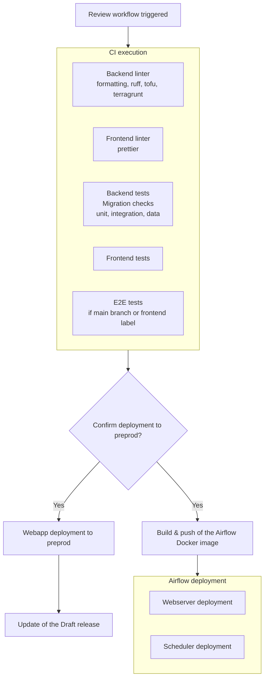
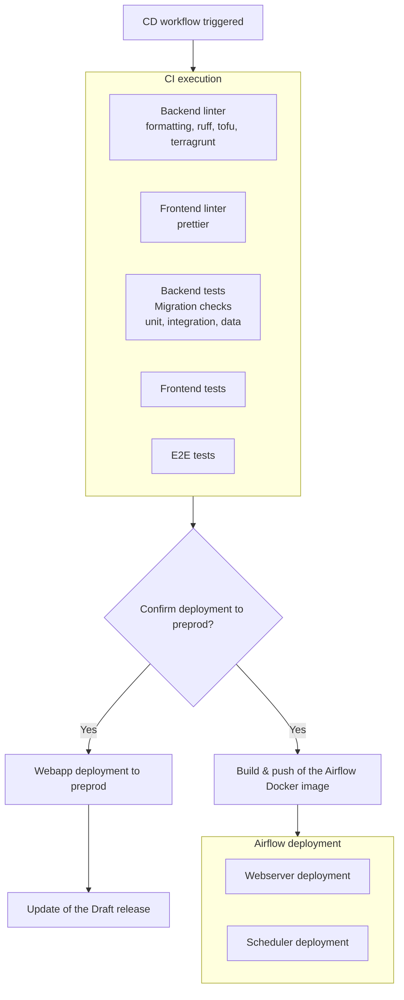
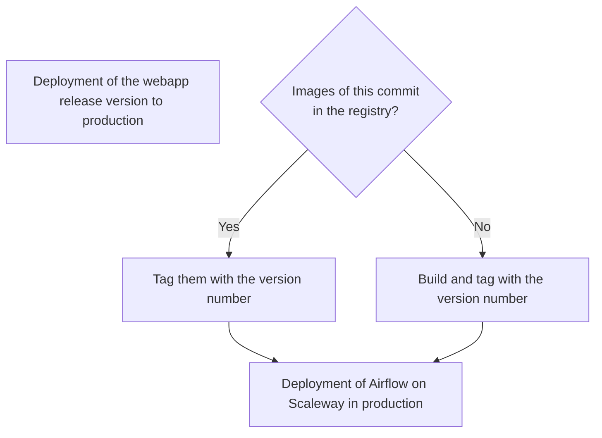

# CI/CD Documentation

This documentation describes the different CI/CD workflows of the project and what happens in each use case.

## Python / uv in CI

Backend jobs use a **single workspace virtual environment** at the repo root, synced with semantic dependency groups:

- **`--group lint`**: Black + Ruff for CI linter.
- **`--group dev`**: lint + test (pytest, factory-boy) + djade + pre-commit for CI tests / checks.
- **`--group dev --group webapp-dev`**: Full local dev (adds Django runserver tooling, debug toolbar, etc.).

`uv sync` always runs from the repo root (the workspace root). The reusable job [`.github/workflows/_backend-test-job.yml`](https://github.com/incubateur-ademe/quefairedemesobjets/blob/main/.github/workflows/_backend-test-job.yml) syncs `--group dev` from root, then runs `make -C <webapp|data-platform> <target>`.

## Creating or updating a Pull Request

When a Pull Request is created, updated or marked as ready for review (events `opened`, `synchronize`, `ready_for_review` or `converted_to_draft`), the **Review** workflow ([review.yml](https://github.com/incubateur-ademe/quefairedemesobjets/blob/main/.github/workflows/review.yml)) is triggered.

Tests and linters are run and it is possible to deploy the PR branch to the `preprod` environment.

Draft pull requests run no CI, E2E or deployment: they start when the pull request is marked as ready for review, and converting a pull request to draft cancels what is running.

In a [stack of pull requests](https://docs.github.com/en/pull-requests/how-tos/merge-and-close-pull-requests/optimizing-ci-for-stacked-pull-requests), only the top pull request runs CI, E2E and deployments, as it contains the changes of the whole stack. Lower pull requests report the required checks as skipped so they stay mergeable, which means a lower pull request can merge even if the top one fails: check the top pull request before merging.

The `Check draft and stack` job reads this from the API rather than from the event, as it is more recent than the payload. `gh stack submit` opens each pull request before linking the stack and no workflow event follows, so a pull request opened as ready for review usually does not know its stack yet and runs CI once.

To avoid this, open a stack as drafts, then mark its pull requests as ready: `gh stack submit --auto` creates drafts by default, unlike `--open` or the interactive editor. A push made before linking new pull requests into a stack has the same effect on the pull request that was the top one.

When the top pull request is closed without merging, the new top keeps its skipped checks until its next push.

On a Pull Request, only the jobs matching the changed files run: [ci-areas.yml](https://github.com/incubateur-ademe/quefairedemesobjets/blob/main/.github/ci-areas.yml) maps files to areas for `dorny/paths-filter`, and an unrecognised file runs everything. In a stack, files are compared with the stack base, so the top pull request covers the whole stack. `webapp` and `data-platform` are tested together because the DAGs import the webapp. Everything runs on `main`.

The `skip` input of `ci.yml` is applied inside `_backend-test-job.yml`, not on the calling job, because a skipped calling job never reports the required `... / run` checks.

Backend tests run on 4 pytest-xdist workers, against PostgreSQL in memory. Migrations are the slowest part of a test run and each worker would replay them, so [prepare-test-databases](https://github.com/incubateur-ademe/quefairedemesobjets/blob/main/.github/actions/prepare-test-databases/action.yml) restores a dump cached on `uv.lock` and the migrations, then clones it per worker. A pull request that changes either migrates once per job, until `main` has saved the new dump.

### Review workflow flow

## Merging a PR into main

When a Pull Request is merged into the `main` branch, the **CD** workflow ([cd.yml](https://github.com/incubateur-ademe/quefairedemesobjets/blob/main/.github/workflows/cd.yml)) is triggered.

The workflow is very similar to the review workflow: tests and linters are run and it is possible to deploy the `main` branch to the `preprod` environment.

A new commit on `main` cancels the run in progress, so only the last commit gets deployed.

### CD workflow flow

## Publishing a release

When a release is published on GitHub (event `published`), the **Deploy** workflow ([deploy.yml](https://github.com/incubateur-ademe/quefairedemesobjets/blob/main/.github/workflows/deploy.yml)) is triggered to deploy to production.

The tagged version of the code is deployed to the `prod` environment. Airflow images built for `preprod` on the same commit are tagged with the version number instead of being built again. If one is missing, for example because of the registry cleanup, all of them are built.

### Deploy workflow flow

## Scheduled workflows

### Database synchronization

The `sync_databases.yml` workflow synchronizes production data to preproduction.

**Schedule**: Every Sunday at midnight (cron: `0 0 * * SUN`)

**Actions performed**:

- Restore the production database to preproduction
- Run migrations in a one-off container
- Reset the suggestions table
- Create the remote database server between webapp and warehouse
- Synchronize S3 buckets (copy from prod to preprod)

### Dependabot

The `dependabot.yml` file configures automatic dependency updates.

**Schedule**: Every Tuesday at 06:00 UTC

**Ecosystems monitored**:

- **uv**: Python dependencies (weekly)
- **npm**: JavaScript dependencies (weekly, grouped by categories: parcel, jest, eslint)
- **GitHub Actions**: Actions used in the workflows (weekly)
- **Terraform**: Terraform modules in `/infrastructure` (weekly)

### Documentation publication

The `publish-docs.yml` workflow automatically publishes the documentation to GitHub Pages.

**Trigger**: On every push to the `main` branch

The documentation is available here: https://incubateur-ademe.github.io/quefairedemesobjets/README.html

## Environments

The project uses several GitHub environments to store environment variables specific to each of them: **preprod** and **prod**.

## Notifications

Production deployments trigger Mattermost notifications in the `lvao-tour-de-controle` channel:

- Deployment start notification
- Success notification with URL
- Failure notification with a link to the logs
- Notification if the site is down after deployment
